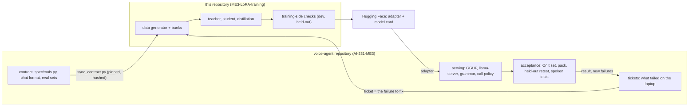

# Architecture: what this repository owns, what the voice-agent repository owns

Two repositories, one thin interface between them.



## Who owns what

| Concern | Owner | Why there |
| --- | --- | --- |
| The line language (`NAME|arg|arg`), tool list, grammar | **voice-agent** (`finetune/spec/tools.py`) | the pipeline parses and executes it; a change to it is a change to the product |
| The chat format and system message | **voice-agent** (`finetune/data/format.py`) | serving builds the same messages |
| The evaluation sets (OnIt set, 87-prompt pack) | **voice-agent** | they score the whole agent, and must stay out of the training data |
| What to fix next (tickets, laptop test results, hard-phrasing probes) | **voice-agent** (`.scratch/router-web-answer/tickets/`) | the failures are seen on the laptop |
| Merge into the base, GGUF conversion, quantisation, `llama-server`, the call-policy layer, `ROUTER_MODEL` | **voice-agent** | runs on the laptop, next to the speech and agent stack |
| Acceptance: OnIt set, pack, held-out retest, spoken sessions | **voice-agent** | needs the real pipeline |
| Wordings and word lists (`data/banks.py`), the generator, seeds, mix weights | **this repository** | training data design, changes every round |
| Teacher and student training, distillation, the teacher-logit cache | **this repository** | needs a GPU node, not the laptop |
| Training-side checks: dev split per kind, hand-written held-out cases | **this repository** | the gate before an adapter is handed over |
| Released data, model card, the round-by-round log | **this repository** | reproducibility and transparency |

The rule of thumb: **if it needs the running agent, it is the voice-agent repository's; if it needs a GPU and the data, it is
this one's.** The contract is the only thing both depend on, so it flows one way, from the voice-agent repository to here.

## The contract copies

`contract.lock.json` pins the five files taken from the voice-agent repository (sha256 of each, plus the commit they came
from). `tests/test_contract.py` fails if a copy was edited here, and fails if training code reaches into the voice-agent
repository's directory layout. To follow a change in the contract:

```bash
python scripts/sync_contract.py --diff ../AI-231-ME3            # is there drift?
python scripts/sync_contract.py --update-from ../AI-231-ME3     # copy the files, rewrite the lock
pytest -q                                                       # banks and seeds still agree with the contract
```

A change to the line language starts in the voice-agent repository (for example a new slot on a call), is merged there, and
is then synced here; the generator and the banks are then updated in this repository to teach it.

## Handoff

**In (from the voice-agent repository):** a ticket naming the failure, with the contract at a commit. Rules for tickets are
in the ticket itself (what to do, what not to look at, acceptance criteria).

**Out (from this repository):**

1. A LoRA adapter on `ibm-granite/granite-4.0-h-350m` pushed to Hugging Face, with its model card (`MODEL-CARD.md`).
2. The training-side results: dev per kind, the hand-written held-out check, the previous model next to it, data counts
   before and after, deviations from the ticket's recipe, and what is the owner's decision.
3. The data and the commit that produced it, so the round can be reproduced.

**Then, in the voice-agent repository (not here):**

1. Merge the adapter into the base in bf16 on the CPU; convert with the base tokenizer and config; quantise to Q4_K_M
   (`train/export.py` prints the steps and holds the notes on the pitfalls).
2. Serve with `llama-server` and the grammar; set `ROUTER_MODEL` for `make up`.
3. Score the OnIt set (`finetune/eval/onit_eval.py`) and the pack, run the held-out retest and the hard-phrasing probe,
   run a spoken session. Acceptance bars are in the ticket.
4. Record the result in the voice-agent progress log; new failures become the next ticket.

When the laptop accepts an adapter, it is renamed from `...-unverified` and the model card gets the laptop numbers (that is
how `kd-web4-s0` became the production router).

## What was deliberately left out of this repository

- The pipeline, the speech server, the agent harness, the call policy, and the scorer `eval/onit_eval.py` (all need the
  running stack).
- The authoring script for the OnIt set (`eval/onit_prompts.py`): the set is the voice-agent repository's, this repository
  only holds the file it needs for the leak filter.
- The tickets: they describe laptop observations and live next to the product's progress log.
